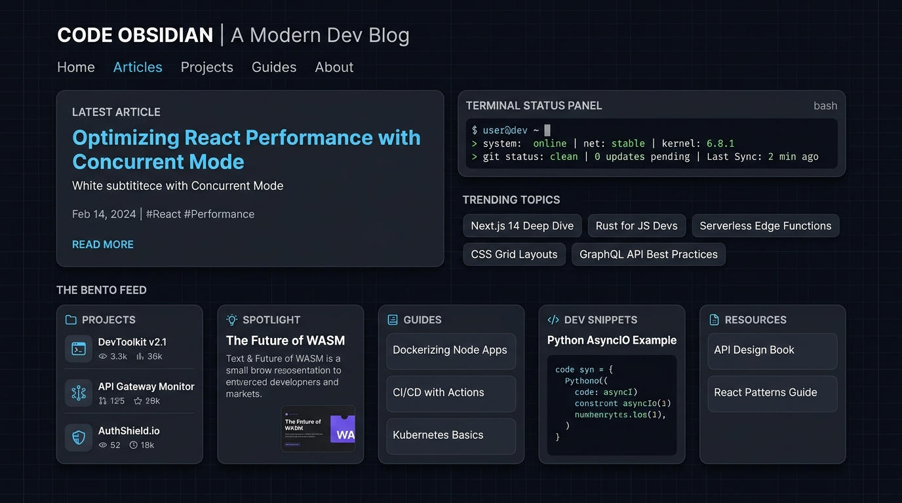

# 溯光 · TraceLight — 现代诗意极客工程风 Typecho 主题


> **「溯光而行，以码载道」**
> 当前发布版本：**`V0.35`**（详见 [CHANGELOG.md](./CHANGELOG.md)）
> 灵感源自 **Linear / Vercel / Raycast** 的工程美学：**深空黑曜石底色 + 微弱鼠标追光网格 + Bento Grid 便当盒布局 + 精准等宽字体排版**。
> 原生支持暗/亮双色无缝切换、零重型第三方 JS 库依赖（纯原生 ES6+），且**无需修改 Typecho 原生数据库表结构**（点赞与阅读量自动持久化至原生 `table.fields`）。



---

## ✨ 核心特性 (Features)

- **全终端自适应流体布局 + 2K/4K 优化 + 银河星空背景**：正文采用 `clamp(1180px, 86vw, 1760px)` 流体容器与超宽屏 `3~4` 列扩展网格，保持饱满大气视野；内置银河星空全站背景与磨砂毛玻璃透明卡片开关，兼顾绚丽质感与高对比阅读。
- **零表结构入侵数据统计**：通过 `themeInit` 钩子自动拦截阅读与 AJAX 点赞请求（含同源校验与并发安全更新），直接持久化至 Typecho 原生 `table.fields`，兼容 Typecho 1.2/1.3、PHP 7.4–8.3 与 MySQL / PostgreSQL / SQLite。
- **内置站点地图 + 后台 10 套代码高亮主题 + 输入法级评论表情**：
  - 原生集成 XML Sitemap（`?do=sitemap` / 可配合 Nginx 伪静态暴露 `/sitemap.xml`），右下角页脚直达 `Sitemap`，不占用顶部主导航空间
  - 支持在 Typecho 外观设置中统一选择 10 套代码高亮主题（Tokyo Night / GitHub Dark / One Dark Pro / Dracula / Nord / Monokai Sublime / Night Owl / Solarized Dark / VS Code Dark+ / GitHub Light）
  - 评论提交栏左侧内置 `😊 表情` 按钮，点击弹出 5 大分类 120 枚输入法级常见表情面板（表情 / 手势 / 极客 / 自然 / 日常）并精准插入光标，同时支持 AJAX 无刷新提交与防连击节流
- **文章封面随机接口 + 自动换图 + 版权与全平台分享**：
  - 全局与单篇可选 **自动生成 SVG 几何封面 (`auto`)**、**随机图片 API 接口 (`randomCoverApi` / 自动换图+本地兜底)** 或自定义 `cover` URL
  - 内置 **CC BY-NC-SA 4.0 / CC BY 4.0 / All Rights Reserved** 内容版权许可声明卡片
  - 内置国内外全平台分享图标栏：**微信、微博、QQ、豆瓣、X (Twitter)、Telegram、Reddit、LinkedIn、复制链接**
- **报刊级 Markdown 增强体系**：
  - 支持 Obsidian / GitHub 风格 5 种 Callout 提示框（`[!NOTE]`、`[!INFO]`、`[!TIP]`、`[!WARNING]`、`[!DANGER]`）
  - 同一段落连续两张图片自动转换为双列 Bento 画廊与图注（`<div class="gallery-2">`）
  - 代码块自动识别语言、彩色语法高亮并注入一键复制按钮，表格具备完整横纵框线
  - 全局文章首字下沉（Drop Cap），支持单篇文章通过自定义字段 `dropcap = 0` 单独关闭
- **7 大特色独立页面模板（统一导航图标）**：
  - `碎碎念 (Moments)`：朋友圈式体验，支持选择本地图片 / 添加图片 URL（最多 9 图宫格）与地理坐标定位，点击大图灯箱预览
  - `时光归档 (Archive)`：支持按年份切换（近一年 / 2026 / 2025 / 2024...）与月份/星期坐标轴的铺满宽屏热力图 + 分类 Bento 矩阵 + 时间轴
  - `书签库 (Bookmarks)`：14+ 精选工程文档、系统内核、效率工具与设计灵感收藏矩阵
  - `实验室 (Projects)`：个人开源作品与实验原型展示墙，支持 Active/Beta/Archived 状态筛选
  - `友邻 (Links)`：正文按行解析生成 Bento 友链卡片，支持延迟探测与申请规范指引
  - `关于 (About)`：工程师名片 + 技术能力雷达 + `NOW` 近况面板 + 工程履历时间线 + `Uses` 装备工作流 + 精选项目
  - `站点地图 (Sitemap)`：可视化全站页面/分类/标签/文章目录树，关联标准 XML Sitemap

---

## 📦 目录结构 (Directory Structure)

```text
TraceLight/
├── .github/
│   ├── ISSUE_TEMPLATE/
│   │   └── bug_report.md      # Issue 反馈模板
│   └── workflows/
│       └── release.yml        # Tag 触发自动构建主题 ZIP 发布包
├── assets/
│   ├── bg/
│   │   └── galaxy.jpg         # 主题内置默认银河星空全局背景图
│   ├── covers/
│   │   └── cover-1..3.jpg     # 内置随机艺术封面图库
│   ├── css/
│   │   └── style.css          # 设计变量、暗/亮双主题、1200px 居中与玻璃透明排版
│   └── js/
│       └── main.js            # 追光背景、TOC 监听、代码主题切换、评论表情与热力图等
├── .gitignore                 # Git 忽略规则
├── CHANGELOG.md               # 版本变更日志
├── CONTRIBUTING.md            # 二次开发与贡献指南
├── LICENSE                    # MIT 开源协议
├── README.md                  # 项目说明与部署文档
├── comments.php               # 嵌套评论区（博主徽章 + UA 标识 + 表情快捷栏）
├── footer.php                 # 全局页脚、Sitemap/RSS 入口、Cmd+K 搜索框与灯箱
├── functions.php              # 核心引擎（themeConfig、XML Sitemap、安全过滤与热力图聚合）
├── header.php                 # 全局头部、SEO 元标签、银河背景层、代码高亮 CSS 与导航
├── index.php                  # 首页（Hero + 拟真 fastfetch 终端面板 + Bento 文章流）
├── page-about.php             # 独立页模板：关于 (About)
├── page-archive.php           # 独立页模板：时光归档 (Archive)
├── page-bookmarks.php         # 独立页模板：书签库 (Bookmarks)
├── page-links.php             # 独立页模板：友邻 (Links)
├── page-moments.php           # 独立页模板：碎碎念 (Moments)
├── page-projects.php          # 独立页模板：实验室 (Projects)
├── page-sitemap.php           # 独立页模板：站点地图 (Sitemap)
├── page.php                   # 默认独立页面模板
├── post.php                   # 文章详情页（首字下沉、TOC、版权分享、点赞打赏与评论）
└── screenshot.jpg             # Typecho 后台主题预览图
```

---

## 🚀 安装与部署 (Installation)

### 环境要求
- **Typecho**：`1.2.0` 及以上版本（兼容 Typecho 1.2.x / 1.3）
- **PHP**：`7.4` ~ `8.3`
- **数据库**：MySQL 5.7/8.x、PostgreSQL、SQLite 3

### 1. 下载并安装主题（当前发版 `V0.35`）

方式 A：直接从 GitHub **Releases** 下载 `TraceLight-V0.35.zip` 压缩包，解压后确保目录结构为 `/usr/themes/TraceLight/index.php`。

方式 B：使用 Git 克隆仓库并检出 `V0.35` 发行标签：
```bash
cd /path/to/typecho/usr/themes/
git clone --branch V0.35 https://github.com/<your-username>/typecho-theme-tracelight.git TraceLight
```

### 1.5 Git 发版与 GitHub Actions 自动打包说明
仓库内置 `.github/workflows/release.yml`，支持 `v*` 与 `V*` 标签触发自动 PHP 语法校验并打包 `TraceLight-V0.35.zip` 发布至 GitHub Releases：
```bash
git remote add origin https://github.com/<your-username>/typecho-theme-tracelight.git
git push -u origin main
git push origin V0.35
```

### 2. 启用与外观配置
1. 登录 Typecho 后台 → **控制台** → **外观**，找到 `TraceLight (溯光)` 并点击 **启用**。
2. 点击 **设置外观**，按需配置头像、全局默认背景图片（默认启用内置银河星空）、毛玻璃透明开关、代码高亮风格、打赏码与 SEO 元标签。

### 3. 创建 7 个特色独立页面
进入 Typecho 后台 → **管理** → **独立页面** → **新增**，在右侧「自定义模板」中选择对应模板并发布：

| 页面标题建议 | 缩略名 (Slug) | 右侧选择自定义模板 | 特殊配置说明 |
| :--- | :--- | :--- | :--- |
| 碎碎念 | `moments` | `碎碎念 (Moments)` | **必须勾选「允许评论」**，支持多图朋友圈动态发布 |
| 时光归档 | `archive` | `时光归档 (Archive)` | 自动聚合全站文章并生成年度热力图与时间轴 |
| 书签库 | `bookmarks` | `书签库 (Bookmarks)` | 正文每行按 `标题 \| URL \| 分类 \| 短评` 填写即可渲染 |
| 实验室 | `projects` | `实验室 (Projects)` | 正文每行按 `项目名 \| URL \| 状态 \| 技术栈 \| 指标 \| 简介` 填写 |
| 友邻 | `links` | `友邻 (Links)` | 在正文按每行 `名称 \| URL \| 头像URL \| 简介 \| 标签` 格式填写 |
| 关于 | `about` | `关于 (About)` | 展示名片、技术雷达、Now 近况、履历时间线与 Uses 装备 |

> 💡 **Nginx `/sitemap.xml` 伪静态规则（可选）**：
> 若希望搜索引擎直接访问 `/sitemap.xml`（除默认 `/?do=sitemap` 外），可在站点 Nginx `server` 块中添加：
> ```nginx
> rewrite ^/sitemap\.xml$ /index.php?do=sitemap last;
> ```

---

## 🛠️ 二次开发指南 (Development)

| 变量名 | Dark 默认值 | Light 默认值 | 用途 |
| :--- | :--- | :--- | :--- |
| `--bg-base` | `#05070c` | `#edf1f7` | 全局画布背景 |
| `--bg-surface` | `rgba(17, 22, 34, 0.86)` | `rgba(255, 255, 255, 0.94)` | Bento 卡片立体表面背景 |
| `--accent` | `#38bdf8` | `#0284c7` | 主焦点强调色（链接、TOC、进度条） |
| `--accent-2` | `#818cf8` | `#4f46e5` | 渐变辅助色 |
| `--font-sans` | `Plus Jakarta Sans, Noto Sans SC` | 同左 | 标题与正文无衬线字体 |
| `--font-mono` | `JetBrains Mono` | 同左 | 代码块、终端与等宽数字 |

## 📄 开源协议 (License)

本项目基于 [MIT License](./LICENSE) 开源，欢迎自由使用、修改与二次分发，保留原作者版权声明即可。
